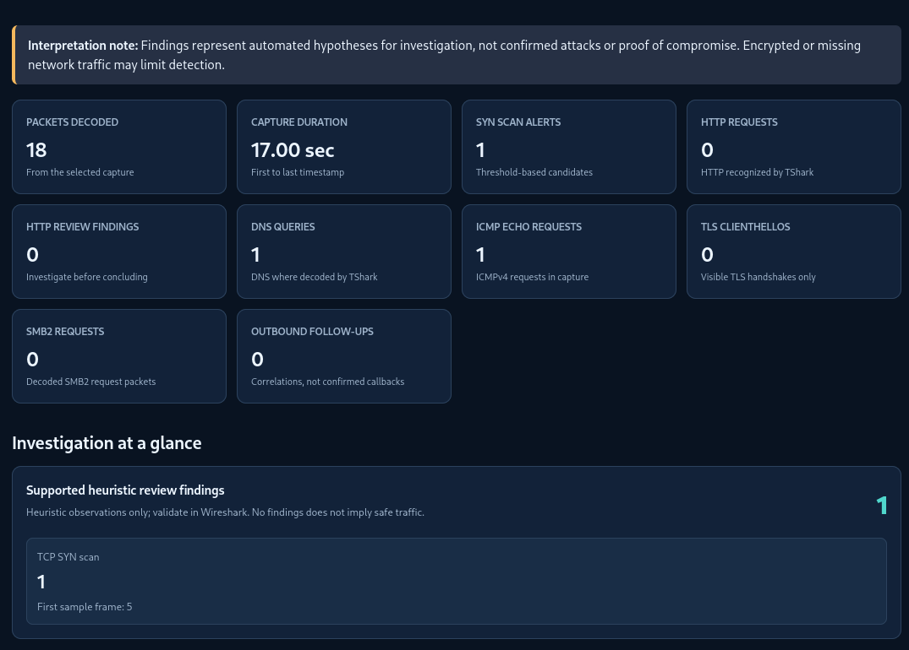
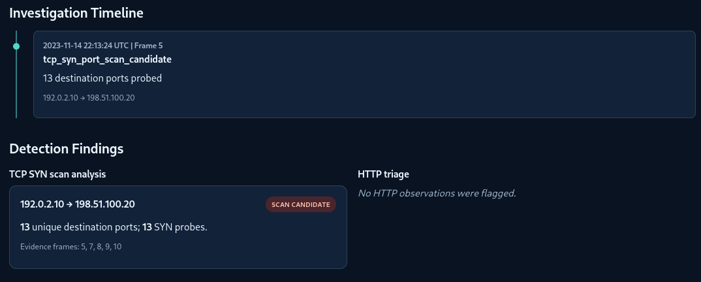

# TraceForge — Offline Network Investigation

**Tagline:** From raw PCAPs to evidence-backed analyst triage.

TraceForge is a read-only Python/TShark tool for reviewing **authorized** `.pcap` and `.pcapng` files. It creates a standalone HTML investigation report, structured JSON findings, and a concise CLI summary.

> **Release status:** TraceForge v1.1.0 is being prepared for publication. On Kali, 85 unit tests and four capture runs completed successfully. See [validation evidence](docs/VALIDATION.md) and [current CI](https://github.com/sumair00190/TraceForge/actions). Findings require analyst validation.

## Investigation preview (synthetic demo)

**Offline synthetic capture — not confirmed malicious activity.** The examples below use documentation-only IP addresses and one *heuristic* TCP SYN scan candidate; all evidence needs independent Wireshark review. The images are cropped to exclude personal browser tabs and local file paths.

**Investigation overview:** decoded packet totals, SYN scan candidate count and the analyst summary.



**Evidence-led analysis:** investigation timeline, source/destination documentation IPs and Wireshark frame references.



## Supported capture formats

| Filename extension | Reader | Scope |
| --- | --- | --- |
| `.pcap` | TShark / libpcap | Metadata inventory and available protocol-specific heuristics |
| `.pcapng` | TShark / PCAP Next Generation | Same analyzer; multi-interface and other capture metadata may be present |
| `.cap` | TShark where the contents are supported | File extension is accepted; the file must contain a TShark-readable capture |

**Compatibility is not universal detection.** Corrupted files, unknown link-layer types, unsupported dissectors, missing packets or encrypted application payloads can limit analysis. Other formats supported by Wireshark are *not necessarily accepted* by TraceForge's extension check. A file named `.pcp` is not one of the accepted formats. CLI errors are expected for unreadable files.

To reproduce protocol-format compatibility without downloading anyone else's captures, generate a synthetic demo as either `.pcap` or `.pcapng` using the same generator; a `.cap` output contains classic libpcap bytes. The CI smoke test compares results across all three extensions.

```bash
python3 scripts/generate_demo_capture.py --scenario scan --output demo/compat.pcapng
traceforge demo/compat.pcapng
```

## Capabilities

| Module | What is measured/flagged |
| --- | --- |
| Capture-wide protocol inventory | One primary protocol family per captured packet (including ARP, IPv4/IPv6, DNS, TLS, SMB, SSH, QUIC, HTTP/2, generic TCP/UDP and Other/undecoded); duration, non-IP and wire-byte summary |
| Traffic overview | Packet counts, top source IPs, destination ports |
| TCP scans | Unique SYN destination ports; configurable alert threshold |
| HTTP triage | Scanner User-Agent patterns, repeated `401`, Tomcat Manager candidate access, suspicious management `POST` |
| DNS | Query/response counts, bounded anomaly heuristics; hostnames omitted from reports |
| ICMP | Echo request/reply counts, unmatched requests, possible sweeps |
| TLS | Decoded ClientHello/ServerHello and version metadata; visible SNI counts, not values |
| SMB2 / PsExec | SMB2 request counts, recognized `ADMIN$`/`IPC$` administrative shares and `PSEXESVC.exe` file activity with frame/stream references |
| Correlation | Selected HTTP management POST followed by outbound SYN candidates and basic stream evidence |
| Outputs | HTML timeline/evidence summary + JSON + terminal |
| Forensic provenance | TShark version, file size, analysis time, threshold and opt-in SHA-256 capture fingerprint |

TraceForge can open ordinary TShark-supported PCAP/PCAPNG/CAP files regardless of the protocol present; its **capture-wide inventory** reports primary decoded protocol families even without an alert. This does **not** mean detailed detection rules exist for every protocol. For example, SSH/QUIC/HTTP2 may be inventoried but not analyzed for attacks.

These are *heuristic observations*, **not confirmed attacks**. Encrypted application data, missing packets, ECH, QUIC, HTTP/2, and unrecognized protocols can cause missed detections. Some rules (e.g., `/manager/html` and `PSEXESVC.exe`) are product-specific and are clearly identified as such. An administrative share or PsExec executable is not proof of unauthorized access.

## Installable CLI, automated testing and offline demo

This fresh repository contains the v1.1.0 source. Release tagging and the GitHub Release page are pending. No PyPI publication is claimed.

For an installable command and a safe, reproducible six-packet demo:

```bash
python3 -m venv .venv
source .venv/bin/activate
python3 -m pip install .
traceforge --version
traceforge-batch --version
python3 scripts/generate_demo_capture.py --output demo/traceforge-demo.pcap
traceforge demo/traceforge-demo.pcap
xdg-open reports/traceforge-demo-report.html
```

The virtual environment keeps the installed CLI isolated from Kali's system Python. The baseline capture uses documentation-only IPv4 addresses and contains synthetic ARP, DNS, ICMP and TCP exchanges.

### Demonstrate an investigation finding

A second **entirely synthetic offline** scenario adds twelve TCP SYN frames targeting distinct destination ports. No network probing occurs; the generator simply creates a PCAP.

```bash
python3 scripts/generate_demo_capture.py --scenario scan
traceforge demo/traceforge-scan-demo.pcap
xdg-open reports/traceforge-scan-demo-report.html
```

Expected on the demo PCAP: 18 packets, 13 distinct destination ports, one *possible* SYN scan alert, a **top-of-report analyst overview**, and packet-frame evidence. This is an intentional simulated finding, **not a real attack or a measured detection rate**. Show the capture label and explanation when sharing any screenshot.

The generator keeps all demo frames deterministic so tests can compare expected results. A [reproducible evaluator walkthrough](docs/DEMO.md) includes expected evidence and safe screenshot guidance. No third-party traffic or private training captures are included. For testing, run `python3 -m unittest discover -s tests -q`. GitHub Actions also runs a Python matrix and a TShark smoke test; do not claim CI passed until the Actions run actually succeeds.

## Configurable SYN scan profiles (development)

Use `--profile sensitive` (5 destination ports), `--profile balanced` (10, default), or `--profile conservative` (25) with either `traceforge` or `traceforge-batch`. For custom thresholds use `--threshold 15`; repeatable local JSON settings can be loaded with `--config config/example.json`.

```bash
traceforge demo/traceforge-scan-demo.pcap --profile conservative
traceforge-batch demo --config config/example.json --output-dir reports/batch
```

Profiles affect **only the TCP SYN scan unique-port heuristic** — not all protocols, not universal attack detection. See [sensitivity settings and limitations](docs/CONFIGURATION.md).

## Batch investigation (development)

Run the installed `traceforge-batch` command against a directory of authorized `.pcap`, `.pcapng`, and `.cap` files:

```bash
traceforge-batch /path/to/capture-folder --output-dir reports/batch
xdg-open reports/batch/batch-report.html
```

Each capture gets its own numbered evidence-backed JSON/HTML report. The batch dashboard summarizes packet counts, supported review findings, and failures. Recursive search, SHA-256 fingerprinting, and JSON-only output are available as opt-in flags. This is **not** cross-file deduplication or guaranteed attack-chain correlation. See [Batch Investigation Guide](docs/BATCH.md).

## Capture fingerprinting

Include optional file integrity metadata with `traceforge --fingerprint "/path/to/authorized.pcapng"`. This hashes the capture bytes in an extra sequential read and adds the SHA-256, UTC analysis timestamp, configured scan threshold, file size and TShark version to the JSON and offline HTML report. SHA-256 identifies bytes, **not** collection authenticity or forensic chain of custody. For large captures, omit `--fingerprint` if analysis speed matters. See [Capture provenance guide](docs/PROVENANCE.md).

## Project documentation

- [Five-minute offline demo (with expected outputs and evidence)](docs/DEMO.md)
- [Capture provenance and SHA-256](docs/PROVENANCE.md)
- [Batch analysis and safety](docs/BATCH.md)
- [Detection sensitivity and JSON configuration](docs/CONFIGURATION.md)
- [Architecture and privacy boundaries](docs/ARCHITECTURE.md)
- [Testing evidence and known limitations](docs/VALIDATION.md)
- [Release history](CHANGELOG.md)

## Requirements

- Python 3.10+ (runtime standard library; packaging via `pip install .` supported)
- TShark / Wireshark CLI installed and available on `$PATH`

On Kali: `python3 --version && tshark --version | head -1`

## Quick start

```bash
cd ~/TraceForge
python3 traceforge.py --version
python3 traceforge.py "/path/to/your-capture.pcapng"
xdg-open "reports/your-capture-report.html"
```

Additional CLI options:

```bash
python3 traceforge.py --help
python3 traceforge.py --threshold 20 --output-dir reports/review1 "/path/to/capture.pcapng"
python3 traceforge.py --no-html "/path/to/capture.pcap"
```

Replace the example path with an **existing local capture** and use the resulting report filename. Capture files are never bundled in the release ZIP.

## PsExec Hunt SMB2 validation

Run this against a local **authorized** PsExec Hunt capture:

```bash
cd ~/TraceForge
python3 traceforge.py "$(find ~ -type f -name 'psexec-hunt.pcapng' -print -quit)"
xdg-open "reports/psexec-hunt-report.html"
```

Look for `SMB2 analysis`, `PsExec service-file candidates` and evidence frames for `PSEXESVC.exe`. The RC2 analyzer found ADMIN$/IPC$ but missed service-file candidates; RC2.1 fixed this on the real capture: 37,686 SMB2 packets and 4 `PSEXESVC.exe` candidates including further activity involving 10.0.0.131. Validate the reported file activity and stream linkage in Wireshark. Confirm the `ADMIN$`/`IPC$` share observations manually. Absence of fields in TShark or a partial capture can prevent these findings; a candidate is not proof of malicious execution. Do not add the lab capture to Git.

## Testing

```bash
cd ~/TraceForge
python3 -m unittest discover -s tests -v
```

**Previous module validation (outputs from the user's Kali tests; not independent cross-environment validation):**

- `web server.pcap` / Tomcat Takeover: 21,070 packets; SYN scan (9,426 unique destination ports); HTTP enumeration; repeated 401s; management request/correlation; outbound port 80/443 stream evidence.
- `dns-icmp.pcapng`: 33 packets; 6 DNS queries + 5 responses; 12 ICMP Echo Requests + 10 replies; no ping sweep alert.
- `tls12-dsb.pcapng`: 17 packets; 2 TLS ClientHellos + 2 ServerHellos, TLS 1.2, 1 visible certificate handshake message. This capture includes decryption secrets and TShark also decoded 2 HTTP request/response pairs.

## Security and privacy

- Offline, read-only analysis: no transmission, scanning, active probes, or external API calls.
- No HTTP body, credential, authentication header, cookie, URL query, raw SNI, SMB filename paths, share server names or NTLM credentials exported. However, **IP addresses, packet numbers and other metadata in generated reports can still be sensitive**. Review before sharing any report.
- The generated HTML has no remote assets or scripts and escapes untrusted content.
- `.gitignore` excludes local captures and reports so they are not accidentally committed.

**v1.0 testing note:** 54 automated tests passed on Kali. RC3 was run against three locally available captures: PsExec Hunt (4 PsExec service-file candidates, SMB shares), DNS/ICMP (6 DNS queries, 5 responses, 12 ICMP requests and 10 replies) and TLS/HTTP (2 ClientHello and 2 ServerHello, 2 decoded HTTP requests/responses). The previously used Tomcat PCAP is unavailable locally, so no final-version Tomcat regression is claimed. These training captures are not a comprehensive benchmark; file-name activity is an **investigation candidate**, never proof of execution or compromise.

## Quick multi-capture acceptance test

Run TraceForge on the **three currently available, authorized training captures**:

```bash
cd ~/TraceForge
python3 traceforge.py test.capture/dns-icmp.pcapng
python3 traceforge.py test.capture/tls12-dsb.pcapng
python3 traceforge.py "$(find ~ -type f -name 'psexec-hunt.pcapng' -print -quit)"
```

If the Tomcat capture is available again, rerun it separately to extend regression coverage. For every tested capture, the terminal should show **Capture-wide protocol inventory**.
The HTML dashboard should show **Capture-wide Protocol Landscape** even when all attack heuristics show zero. Protocol classification is not proof that payloads were decoded.

## Next work

- Separate analysis logic into reusable modules (single-file layout still used for this RC).
- Add fixtures with expected ground truth and automated integration tests against TShark.
- Validate with benign and malicious captures across other protocols; tune heuristics and record false positives and false negatives.
- Add user-selectable active rule packs and scalable capture processing.

## License and contributing

**Copyright © 2026 sumair00190.** TraceForge is being prepared for open-source release under **Apache License 2.0**. See [LICENSE](LICENSE) and [NOTICE](NOTICE). Apache-2.0 permits commercial use, modification and redistribution subject to its conditions. It does not grant trademark rights or guarantee any detection outcome.

- [Contribution guidelines](CONTRIBUTING.md) — tests, synthetic captures and pull requests
- [Security policy](SECURITY.md) — private vulnerability reporting
- [Community standards](CODE_OF_CONDUCT.md) — respectful technical collaboration
- [Open-source readiness checklist](docs/OPEN_SOURCE_RELEASE_CHECKLIST.md) — release requirements and open items

**Pre-launch status:** This repository remains private. Historical development tags and releases are not included in its fresh Git history.

Built as a cybersecurity learning and defensive research project. Use only captures you have permission to analyze.
